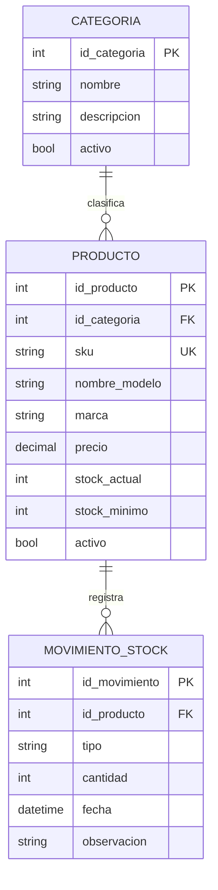

# StockFácil PC — definición inicial del proyecto

## Problema y propósito

Las tiendas pequeñas de artículos de computación necesitan consultar y mantener actualizado el stock de componentes y accesorios. StockFácil PC propone registrar productos por nombre/modelo, SKU, precio y unidades disponibles desde una aplicación Android. El primer avance funciona localmente para que el usuario pueda administrar el inventario desde el teléfono.

El caso de aplicación es una tienda pequeña de artículos de PC. Aún no se ha identificado un establecimiento específico, así que la situación operativa se tratará como un escenario de proyecto y deberá validarse con una entrevista breve antes del informe final.

## Diagnóstico preliminar SEPTE

- **Económico:** PRODUCE informó que más de 500 MYPE participaron en la segunda edición del CyberWow 2025. Esto muestra una oportunidad para que pequeños negocios se integren a canales digitales; al manejar más canales, necesitan mantener el catálogo y las existencias coordinados. La cifra describe participación en una campaña y no demuestra por sí sola un problema de inventario en una tienda concreta.[^1]
- **Tecnológico y social:** en el segundo trimestre de 2025, el 60,1 % de los hogares peruanos tenía conexión a Internet; entre la población usuaria de Internet, el 89,0 % accedía mediante teléfono celular. Esto respalda diseñar una herramienta móvil con funcionamiento local y sincronización posterior, considerando que el acceso a Internet no es universal.[^2]
- **Ecológico y normativo:** el régimen peruano de RAEE establece responsabilidades para actores que participan en el manejo de residuos de aparatos eléctricos y electrónicos. Para una tienda de artículos de PC, el control de productos dañados o fuera de uso puede ser una mejora futura; esta primera versión solo gestiona inventario y no pretende reemplazar las obligaciones ambientales aplicables.[^3]

La evidencia nacional sustenta el contexto general, pero no reemplaza una validación con el negocio objetivo. El informe final debe incorporar una entrevista o evidencia local para confirmar cómo se registran hoy las existencias, qué errores ocurren y quiénes usarían la solución.

## Objetivos SMART preliminares

1. **Desarrollar**, antes de la sustentación final del curso, una aplicación Android que permita al encargado registrar, consultar, buscar, modificar y eliminar productos de PC, manteniendo los datos en SQLite y validando SKU único, precio y stock no negativos.
2. **Integrar**, antes de la sustentación final del curso, la aplicación con el portal administrativo mediante al menos dos recursos REST para consultar y mantener categorías/productos, y enviar movimientos de stock guardados localmente.

Estos objetivos son preliminares y se ajustarán cuando el equipo confirme la fecha de sustentación y el alcance técnico aprobado por el docente.

## Usuarios y casos de uso iniciales

- **Encargado de inventario:** registra productos, busca por nombre o SKU, modifica precio o cantidad y elimina registros obsoletos.
- **Administrador del negocio:** en el portal web, mantendrá el catálogo y revisará los cambios sincronizados desde la app.

## Reglas de negocio iniciales

1. Cada producto debe tener nombre/modelo y un SKU único.
2. El precio y la cantidad no pueden ser negativos.
3. Los productos se almacenan localmente en SQLite y podrán sincronizarse con el portal cuando exista conectividad.
4. El catálogo contempla artículos de computación, por ejemplo componentes, periféricos y accesorios; las categorías definitivas se validarán con el usuario.

## Modelo de datos propuesto

El SQLite que ya está implementado contiene una primera tabla `products` con nombre, SKU, precio y unidades. La separación formal entre categorías, productos y movimientos se incorporará al modelo completo antes de cerrar la base de datos local y remota.

## Servicios REST previstos

- `GET /api/categories` y `GET /api/products`: consultar categorías y catálogo.
- `POST /api/products`, `PUT /api/products/{id}` y `DELETE /api/products/{id}`: mantener productos.
- `POST /api/stock-movements`: registrar ingresos o salidas de inventario.
- `POST /api/sync/products`: enviar al portal los cambios pendientes guardados en el teléfono.

Los nombres son un borrador de diseño; se ajustarán a la tecnología del curso y a la implementación del portal.

## Estado del avance

**Implementado en Android:** pantalla inicial, búsqueda por nombre/SKU, lista personalizada y operaciones SQLite de registro, consulta, modificación y eliminación.

**Siguiente para el avance de curso:** mockups, modelo entidad-relación definitivo, contexto SEPTE con fuentes, portal/API REST inicial y sincronización móvil. Después se completarán el informe, la sustentación y la demostración.

## Fuentes consultadas

[^1]: Ministerio de la Producción (14 de julio de 2025). [PRODUCE impulsa participación de más de 500 MYPE en la segunda edición del CYBERWOW 2025](https://www.gob.pe/institucion/produce/noticias/1208494-produce-impulsa-participacion-de-mas-de-500-mype-en-la-segunda-edicion-del-cyberwow-2025).
[^2]: Instituto Nacional de Estadística e Informática (29 de septiembre de 2025). [El 60,1 % de los hogares tiene conexión a Internet](https://www.gob.pe/institucion/inei/noticias/1254582-el-60-1-de-los-hogares-tiene-conexion-a-internet).
[^3]: Ministerio del Ambiente (8 de noviembre de 2019). [Decreto Supremo N.° 009-2019-MINAM: Régimen Especial de Gestión y Manejo de Residuos de Aparatos Eléctricos y Electrónicos](https://www.gob.pe/institucion/minam/normas-legales/354138-009-2019-minam).
